# Tudor Baranai

Third-year Computer Science student at **Ștefan cel Mare University of Suceava (USV)**. Robotics enthusiast.

## Achievements

**1st place — HARD & SOFT 2026**  
Won with **Team Sudo**, placing first among 16 international teams.

We built **The Guardian**, a wearable fall-detection and vital-monitoring system for elderly care. I worked on the caregiver dashboard, 3D mannequin interface, Supabase data layer, and AI model training.

[View the public project repository](https://github.com/tudorbaranai/guardian-fall-companion)

## Competitions

- **HARD & SOFT** — Competed in 2025 and 2026; first place in 2026 with Team Sudo.
- **25h** — Participated in a 25-hour university competition. Our challenge was to address a climate problem.

More

 

<picture>
  <source media="(prefers-color-scheme: dark)" srcset="https://raw.githubusercontent.com/tudorbaranai/tudorbaranai/output/coding-stats-dark.svg" />
  <source media="(prefers-color-scheme: light)" srcset="https://raw.githubusercontent.com/tudorbaranai/tudorbaranai/output/coding-stats.svg" />
  
</picture>

<picture>
  <source media="(prefers-color-scheme: dark)" srcset="https://raw.githubusercontent.com/tudorbaranai/tudorbaranai/output/github-snake-dark.svg" />
  <source media="(prefers-color-scheme: light)" srcset="https://raw.githubusercontent.com/tudorbaranai/tudorbaranai/output/github-snake.svg" />
  
</picture>
